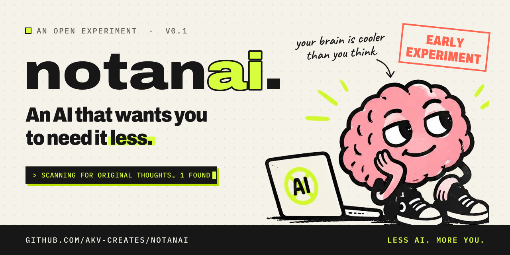
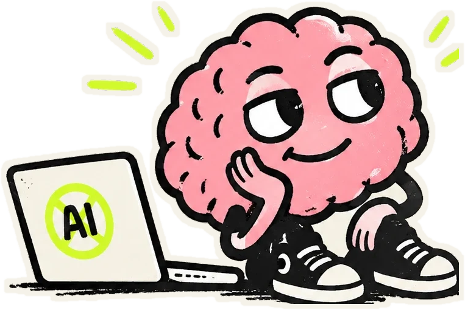
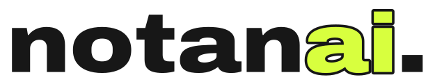

  

  
  
  
  

  <a href="#what-exists-today"><b>What exists</b></a> ·
  <a href="#ideas-not-features"><b>Ideas</b></a> ·
  <a href="#roadmap"><b>Roadmap</b></a> ·
  <a href="#the-code"><b>The code</b></a> ·
  <a href="#come-argue-with-it"><b>Say something</b></a>

 

> ### “What if an AI’s greatest achievement was helping you realise you didn’t need it?”

That’s the whole experiment. **NotAnAI** is a small, independently built website that uses AI to make you a little less dependent on AI. It audits your habits, coaches instead of answering, and sends you to a Brain Gym. It also tells you, with love, when you could have done the thing yourself.

It’s early, it’s a bit ridiculous, and it’s a real question.

<code>§01 — THE CONTRADICTION</code>

## Yes, it’s an AI product about needing AI less.

I see the irony. I’ve decided to find it motivating.

Most AI tools are judged by how much you use them. More prompts, more minutes, more “one quick thing”. Somewhere along the way “Hope this finds you well” got outsourced, and so did the first messy attempt that used to come before every good idea.

NotAnAI flips the scoreboard. **Here, success looks like you needing it less.** It still uses a language model, because the problem was never the tool. The problem is autopilot. The quickest way to show the difference is with an AI that has the audacity to ask what *you* think first.

<code>§02 — WHAT EXISTS TODAY (v0.1)</code>

## What exists today

A single-page website. Part parody, part working prototype. Everything below is built and runs:

- 🪞 **The Dependency Audit.** Seven questions, one unscientific verdict (“The Corporate Autocomplete, 64% outsourced”), and a shareable result card drawn in your browser.
- 🧠 **The Unassistant.** A chat with three thinking modes that genuinely change how it answers. Runs on a real model (Groq or Anthropic), or a clearly labelled scripted demo if none is configured.
- 🏋️ **The Brain Gym.** Three short exercises: the Terrible Ideas Challenge, a Five-Minute Brain Dump and Observation to Idea. Progress and streaks are kept in your browser.
- 🚨 **Emergency Brain.** A button for the moment you’re about to prompt something you could try yourself. Put down the prompt. Write the messy version.
- 📜 **The Manifesto.** Sign it with your own hand. The only witness is Gary.
- 💸 **The Pricing Page.** Three plans: ₹0, ₹0 +, and “please contact your therapist”. Plus a newsletter that subscribes you to nothing.

**One request, three modes.** Ask *“Write a short LinkedIn post about finishing my first marathon.”*

| Mode | What the Unassistant does |
| --- | --- |
| **Think Alone** | Hands you a structure and asks for the one moment you want to lead with. No finished post. |
| **Think Together** | Offers a few angles (the journey, the lesson, the thank-you), then asks for a detail only you know. |
| **Just Help Me** | Writes the draft, explains its choices, and suggests one way to make it more yours. |

The Unassistant’s rules won’t be hidden either. When the code goes public, its instructions go with it, so you can read them, argue with them and send a better version.

> [!NOTE]
> **Privacy, by default.** No accounts and no analytics. Quiz answers, gym progress and chat history stay in your browser’s `localStorage`. There’s a wipe button in the footer. Conversations are sent to the AI provider to generate a reply, and are never stored or logged by this site.

<code>§03 — THE VISION</code>

## Ideas, not features

None of this is built. These are the directions I’m exploring. Some will turn out wrong, and that’s the point of sharing them early.

- 💭 **Assistance that fades.** Help that tapers off as you get better at something, like stabilisers on a bike.
- 💭 **Attempt first.** A gentle 90-second “try it yourself” window before the AI answers, which you can skip with no guilt. Some guilt.
- 💭 **Thinking receipts.** A small, honest note on how much of the final piece came from you and how much from the model.
- 💭 **A nudge where it happens.** A browser companion that notices when you’re about to outsource something tiny, and asks once.
- 💭 **A bigger Brain Gym.** More exercises, ideally designed by people who teach, write and make things for a living.
- 💭 **Open thinking policies.** Unassistant-style rules that other tools could fork, debate and adopt.

<code>§04 — THE PHILOSOPHY</code>

## Not anti-AI. Anti-autopilot.

Use AI to learn faster, build better things and take on work that matters. Then, occasionally, write something terrible, make a weird observation, solve a problem badly, and find out you were capable of more than you expected.

**Technology should strengthen human capability, not replace human initiative.** A good tool leaves you a little more capable each time you use it. A bad one quietly convinces you that you can’t manage without it.

<code>§05 — ROADMAP</code>

## Roadmap

Honest version: this is one person’s side project, built independently and shared early on purpose.

- ✅ **Stage 0 · The joke that became a question.** The website: audit, Unassistant, Brain Gym, Emergency Brain, manifesto. Live model or scripted demo.
- 📍 **Stage 1 · Opening it up** — *you are here.* This README first, the code soon after. Listening for whether the idea resonates. No public deployment yet.
- 🧪 **Stage 2 · Exploring next.** Picking one or two ideas from the list above, based on what people actually respond to. Still local-first.
- 🌱 **Stage 3 · If people care.** Turning it into a proper community project, with shared decisions, more maintainers and a public roadmap.

<code>§06 — THE INVITATION</code>

  

## Come argue with it

There’s no community here yet. You could be the first few people in it.

- **Challenge the idea.** Think it’s naïve, preachy or doomed? [Tell me why](https://github.com/akv-creates/notanai/issues/new). Arguments are as welcome as applause.
- **Share an idea.** A Brain Gym exercise, a mode, a better joke.
- **Get ready to contribute.** The code isn’t public yet. Watch the repo to know when it lands, and say in an issue what you’d like to work on.
- **Star it** if you want to see where it goes. It’s the least effortful thing on this page, which feels off-brand, but fine.

Designers, writers, teachers, developers, product people and the AI-curious are all welcome. You don’t need to write code to make this better.

## The code

The website is built and runs: Next.js 16, React 19, Tailwind CSS 4 and TypeScript, with a live model through Groq or Anthropic, or a scripted demo when no key is set. I’m tidying it up before opening the source here.

**Watch or star the repo** to see it land. It’ll be MIT licensed.

 

  <picture>
    <source media="(prefers-color-scheme: dark)" srcset="assets/logo-dark.svg">
    
  </picture>

<h3 align="center">Somewhere, a sentence of yours misses you.</h3>

Go write it. Badly, if necessary. Then come and tell the Unassistant what you think.

  Built independently by <a href="https://github.com/akv-creates">@akv-creates</a> · Made by a human. Assisted by AI. Emotionally complicated.

